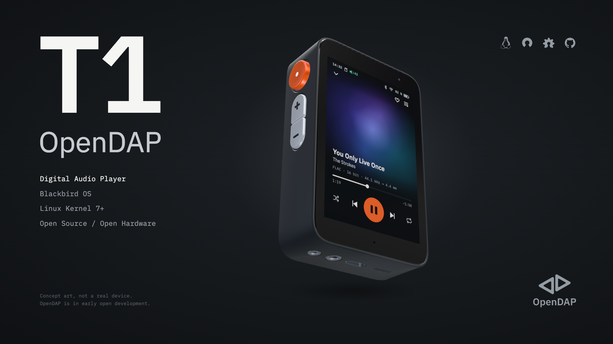

# OpenDAP

OpenDAP is an Open Source, Open Hardware Digital Audio Player (DAP) that runs entirely on Linux. It is also a general-purpose Linux device: accessory **HATs**, mounted on its back, turn it into other tools.

Every part is open: schematics, PCBs, mechanics, operating system, SDK and tooling. You can study it, repair it, modify it and build on it.

## Status

OpenDAP is in **early open development**. Requirements, architecture decisions, the bill of materials and a virtual T1 for software work are public; hardware prototypes are not built yet. Everything here is work in progress and changes as the design is validated.

## Platform

| Part | What it is |
|---|---|
| **OpenDAP T1** | The first DAP, with interchangeable front **faceplates** |
| **Blackbird OS** | The operating system and software experience of the T1, built on Debian |
| **OpenDAP HATs** | Accessories mounted on the back that extend what the device can do, on an open standard |
| **OpenDAP Desktop** | The desktop app for everything you can do with an OpenDAP, from casual use to advanced use |
| **OpenDAP Developer Toolkit** | The `opendap` CLI, SDK and the tools to build, verify and manufacture on the platform |

The T1 will come in two editions built from the same design: a **DIY edition** you assemble yourself and a **Commercial edition**, assembled and tested. They differ in manufacturing, assembly and testing, not in the platform.

## Repositories

| Area | Repository | What it is |
|---|---|---|
| The T1 | [t1](https://github.com/opendap-project/t1) | The OpenDAP T1: product requirements, integration, assembly |
| | [board](https://github.com/opendap-project/board) | The T1's main board, built around the SoC |
| | [case](https://github.com/opendap-project/case) | The T1's rigid mechanics: core (with basic back cover), faceplate mount |
| | [faceplate-touch](https://github.com/opendap-project/faceplate-touch) | The T1's default faceplate: touch display, status LED, microphone |
| | [faceplate-cassette](https://github.com/opendap-project/faceplate-cassette) | Inspired by cassette Walkmans |
| | [faceplate-classic](https://github.com/opendap-project/faceplate-classic) | Inspired by classic portable music players |
| Standard | [hat-standard](https://github.com/opendap-project/hat-standard) | OpenDAP HAT Standard for accessory developers |
| Process | [rfcs](https://github.com/opendap-project/rfcs) | Proposals for cross-repository and interface changes |
| Software | [system](https://github.com/opendap-project/system) | Blackbird OS system software and SDK (Rust) |
| | [blackbird-ui](https://github.com/opendap-project/blackbird-ui) | Blackbird UI: the Engineered Matter design system, tokens, icons and the UI of Blackbird OS |
| | [blackbird-os](https://github.com/opendap-project/blackbird-os) | The Blackbird OS distribution: the image definition and releases |
| | [virtual-devices](https://github.com/opendap-project/virtual-devices) | Virtual OpenDAP devices for development on a computer: hardware layers, models, the emulator tool |
| Desktop and CLI | [desktop](https://github.com/opendap-project/desktop) | OpenDAP Desktop, the desktop app (Rust) |
| | [cli](https://github.com/opendap-project/cli) | The `opendap` command-line tool, for advanced users and package developers |
| Developer Toolkit | [tools](https://github.com/opendap-project/tools) | Maintainers' tools, one folder per domain: host setup; image, sysroot, cross-build and deploy; fab packages, CAD exports, part data and the component export contract; verification from simulations and captured samples; shared pre-commit hooks |
| | [claude-plugins](https://github.com/opendap-project/claude-plugins) | Contributor skills and a commit-check hook for working in OpenDAP repositories |
| Libraries | [libs](https://github.com/opendap-project/libs) | Shared design libraries, one folder per tool: KiCad symbols, footprints, 3D models and fab design rules; per-part records and the manifest of datasheets and vendor models; FreeCAD mechanical parts; Blender materials, models and scenes |
| Official HATs | [hat-powerbank](https://github.com/opendap-project/hat-powerbank) | Powerbank |
| | [hat-nas](https://github.com/opendap-project/hat-nas) | SSD and Ethernet |
| | [hat-camera](https://github.com/opendap-project/hat-camera) | Action camera |
| | [hat-recorder](https://github.com/opendap-project/hat-recorder) | Recorder inspired by Tascam |
| | [hat-oscilloscope](https://github.com/opendap-project/hat-oscilloscope) | Oscilloscope based on the DS212 |
| | [hat-vna](https://github.com/opendap-project/hat-vna) | Vector network analyzer based on NanoVNA |
| | [hat-radio](https://github.com/opendap-project/hat-radio) | SDR based on HackRF Pro |

Faceplates are interchangeable front modules; HATs are accessories mounted on the back. Each HAT is a complete project: hardware, case, firmware, software, Blackbird OS package, its own tooling and, where useful, on-board AI.

## Licensing

| Content | License |
|---|---|
| Hardware of OpenDAP products (schematics, PCB, mechanics) | [CERN-OHL-S-2.0](https://ohwr.org/cern_ohl_s_v2.txt) |
| Hardware building blocks others combine into their own designs: part libraries, OpenDAP HAT Standard reference designs, every `export/` folder | [CERN-OHL-W-2.0](https://ohwr.org/cern_ohl_w_v2.txt) |
| Software | [GPL-3.0-or-later](https://www.gnu.org/licenses/gpl-3.0.html) |
| Software libraries others build on: SDK, design system, schemas | [MPL-2.0](https://www.mozilla.org/MPL/2.0/) |
| Firmware, project templates | [MIT](https://opensource.org/license/mit) |
| Documentation, specifications, manuals, renders, project assets | [CC-BY-SA-4.0](https://creativecommons.org/licenses/by-sa/4.0/) |
| Generic shared assets others can build on (`blender-lib/shared/`) | [CC-BY-4.0](https://creativecommons.org/licenses/by/4.0/) |

Changes to anything OpenDAP publishes stay open. What others build on top (their own hardware, firmware or software) is theirs to license.

Every repository follows the [REUSE](https://reuse.software) layout, so each file's license is machine-readable.

## Conventions

- Everything in the repositories is written in English.
- Each repository keeps its confirmed context in `docs/`: requirements first, then Architecture Decision Records (ADRs) for decisions already taken.
